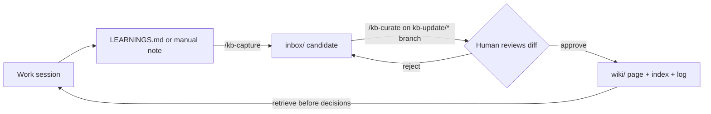

# gsd-agent-wiki

A personal, portable knowledge base for coding agents: durable concepts, patterns, lessons, preferences, and decisions, stored as plain Markdown in a git repo.

> GSD remembers where the work is. gsd-agent-wiki remembers what you have learned.

- **No server, no SDK.** Markdown + YAML frontmatter, following [Open Knowledge Format (OKF) v0.2](https://github.com/GoogleCloudPlatform/open-knowledge-format). Read it with any editor or agent.
- **Reviewed writes only.** Candidates are staged in `inbox/`, then promoted to `wiki/` on a branch after you approve the diff.
- **Works without GSD.** GSD is a convenient source of input, never a dependency. See [harness independence](/docs/harness-independence.md).
- **Cheap retrieval.** Agents read `index.md`, then page descriptions, then search, and open full pages last.

`wiki/` ships with a few generic sample pages (one per category) so you can see the shape. Delete them and start your own, or keep them as seed knowledge.

## Quick start

```bash
git clone https://github.com/<you>/gsd-agent-wiki.git
cd gsd-agent-wiki
claude --add-dir /path/to/gsd-agent-wiki     # from any project; loads this KB's rules for the session
```

| Goal | Do this |
|---|---|
| **Read** | Open [`index.md`](/index.md), pick a category, read a page. Or ask your agent: "check the KB for patterns on retries". |
| **Capture** | `/kb-capture <phase>` reads a GSD phase's `LEARNINGS.md` and stages one candidate in `inbox/session-extracts/`. Without GSD, write a note in `inbox/manual-notes/` using [`templates/candidate-template.md`](/templates/candidate-template.md). |
| **Curate** | `/kb-curate` creates a `kb-update/*` branch, proposes where each item goes, shows you the full diff, and commits only after you approve. |
| **Check health** | `/kb-lint` reports broken links, orphan pages, and frontmatter drift. It never edits files. |

A page looks like this:

```markdown
---
type: pattern
title: Supersession Over Deletion
description: When new evidence replaces an old claim, mark the old claim superseded with a date and a pointer, never silently delete.
generated: { by: kb-capture/1.0, at: 2026-09-06T00:00:00Z }
verified:
  - { by: human:wesnam, at: 2026-09-06T00:00:00Z }
status: stable
confidence: verified
related:
  - /schemas/ingestion-rules.md
---
Body text, with absolute bundle-relative links like [ingestion rules](/schemas/ingestion-rules.md).
```

Pages specific to a repo or product add `projects: [my-repo]`; pages without it are general, cross-project knowledge.

### Make retrieval automatic

Add a short pointer to your global agent instructions (for example `~/.claude/CLAUDE.md`) so that sessions which never load this repo's `CLAUDE.md` still consult it:

```markdown
## Knowledge base
Before committing to a design or tooling choice, search /path/to/gsd-agent-wiki.
Read in order: index.md, frontmatter descriptions, rg full-text, page bodies.
If the KB conflicts with the current project's evidence, the project wins; flag the conflict.
Never hand-edit wiki/. Use /kb-capture then /kb-curate.
```

`--add-dir` loads the KB's `CLAUDE.md` only for that session. Sessions launched without it see only your global pointer.

## How it works



Layout and design rationale: [docs/ARCHITECTURE.md](/docs/ARCHITECTURE.md).

| Path | Purpose |
|---|---|
| `wiki/` | Canonical knowledge, one folder per category |
| `inbox/` | Staged candidates, not yet canonical |
| `templates/` | Copyable page and candidate shapes |
| `schemas/` | Ingestion rules: what gets promoted and how |
| `.claude/skills/` | `/kb-capture`, `/kb-curate`, `/kb-lint` |
| `index.md`, `log.md` | Reserved files: entry point (declares `okf_version`) and audit trail |
| `CLAUDE.md` | Operating rules loaded by agents |

## Reading this bundle (permissive consumer)

Any reader, human or agent, should degrade gracefully rather than error on missing optional fields, unknown `type` values, unknown frontmatter keys, broken cross-links, or missing `index.md` files. Only `type` is relied on for non-reserved pages. Full rules: [`CLAUDE.md`](/CLAUDE.md) and the [ingestion rules](/schemas/ingestion-rules.md).

## License

[MIT](/LICENSE)
