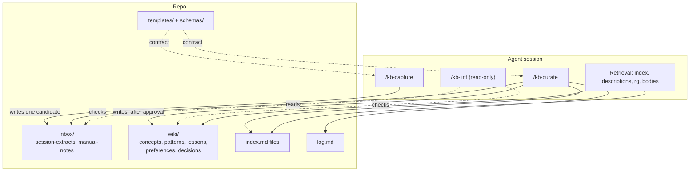
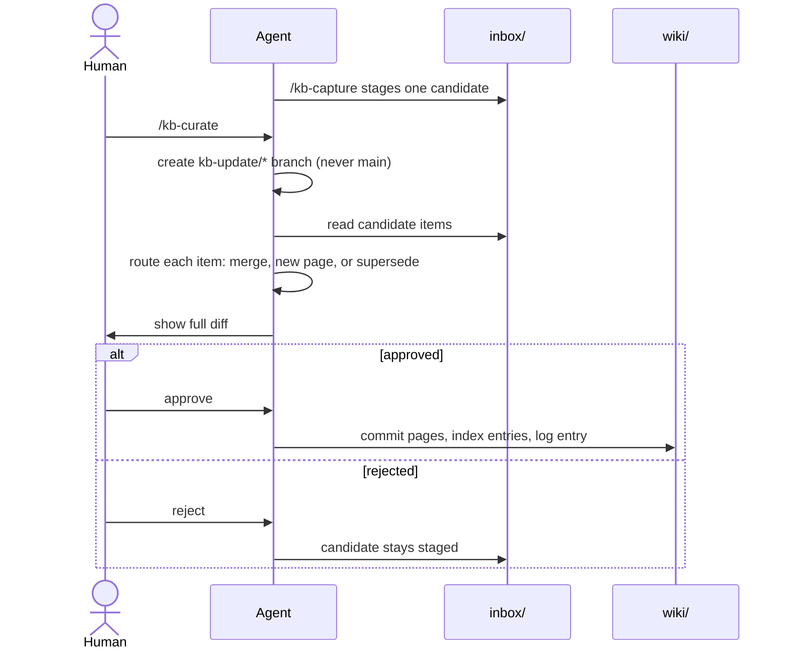
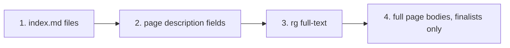
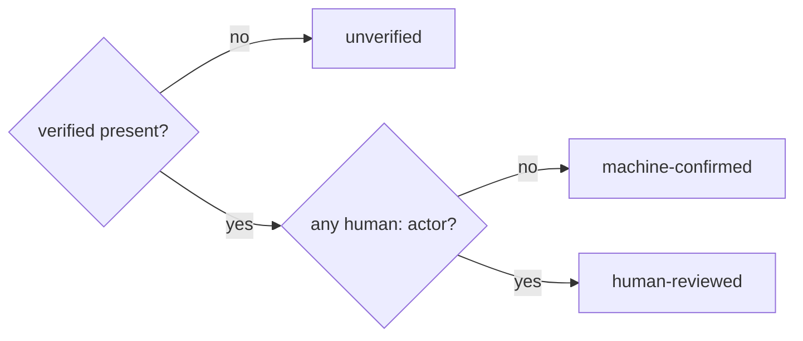
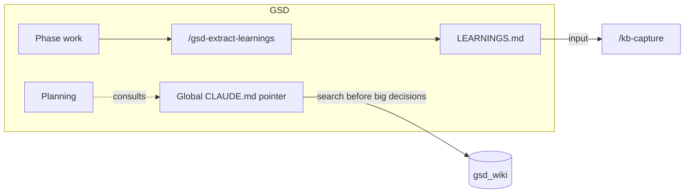

# Architecture

gsd_wiki is the long-term **semantic memory** for coding agents. It is a directory of Markdown files, not a program. The "architecture" is the folder roles, the promotion lifecycle, and the gates that protect canonical knowledge.

## Design goals

| Goal | How it is met |
|---|---|
| Portable | Markdown + YAML + git. Works as a repo, tarball, or mounted folder. |
| Harness-independent | Skills live in this repo, not in a plugin. GSD is an optional input source. See [harness-independence.md](/docs/harness-independence.md). |
| Trustworthy | Writes to `wiki/` pass a branch gate and a human diff gate. Old claims are superseded, never deleted. |
| Cheap to query | Tiered retrieval keeps cost flat as the wiki grows. |
| Fact vs. judgment | `confidence` extension on each page; `generated` and `verified` record who wrote and who confirmed; candidates carry `sources`. |

## Components

| Component | Role | Can write? |
|---|---|---|
| `/kb-capture` | Applies the promotion filter to a `LEARNINGS.md` and stages one candidate | Only to `inbox/session-extracts/` |
| `/kb-curate` | Routes candidate items to pages, updates indexes and log | `wiki/`, indexes, `log.md`, only on `kb-update/*` after approval |
| `/kb-lint` | Reports drift across six checks | No (no `Write` or `Edit` tool) |
| Retrieval | Reads in tiers, not a skill | No |

## Promotion lifecycle

Three gates are non-negotiable: the **branch gate** (`kb-update/*`, never `main`), the **diff gate** (explicit human approval before any `wiki/` commit), and the **supersession gate** (mark old claims superseded with a date and pointer). Details: [ingestion rules](/schemas/ingestion-rules.md).

## Retrieval

Read in this order and stop as soon as you have enough:

A page's one-line `description` is the deciding signal for whether to open it.

## Page contract

Pages follow [OKF v0.2](https://github.com/GoogleCloudPlatform/open-knowledge-format). `okf_version: "0.2"` is declared in the root `index.md`.

| Field | Rule |
|---|---|
| `type` | Required, non-empty. For wiki pages, the singular category name. |
| `generated` | `{ by, at }`: who produced the content and when. |
| `verified` | List of `{ by, at }`. A `human:<id>` entry means human-reviewed. Stamped only by `/kb-curate` after diff approval. |
| `status` | `draft`, `stable`, or `deprecated`. |
| `sources`, `stale_after` | Optional provenance and freshness. |
| `confidence` | Extension: `verified`, `probable`, or `speculative`. |
| `related` | Extension: absolute bundle-relative links (`/wiki/...`), kept bidirectional. |

Trust tier, derived from `verified`:

Reserved files (`index.md`, `log.md`) have no frontmatter. Readers must be permissive: unknown keys, missing fields, and broken links never cause an error. Template: [page-template.md](/templates/page-template.md).

## GSD integration points

GSD is optional. Where it connects:

| Direction | Mechanism | Needs GSD? |
|---|---|---|
| GSD to KB | `/kb-capture` parses GSD's `LEARNINGS.md` | Only to produce that file. A hand-written note in `inbox/manual-notes/` works too. |
| KB to GSD | A pointer in your global `CLAUDE.md` tells any session to search the KB | No |

Known limits: capture currently accepts only the `LEARNINGS.md` format, and retrieval relies on the global pointer rather than a hook into planning.

## Not in scope

No server, database, embeddings, or sync. Search is `rg` over files.
